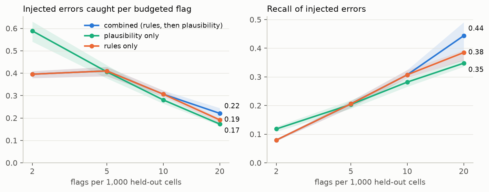
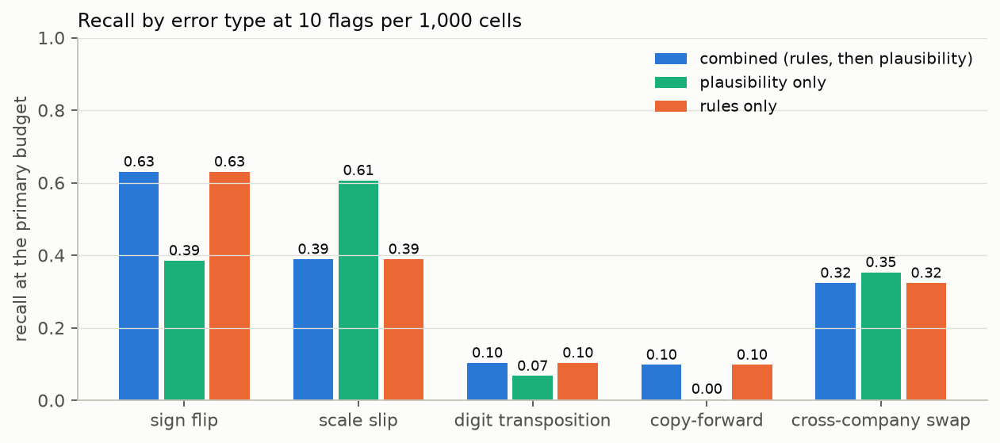
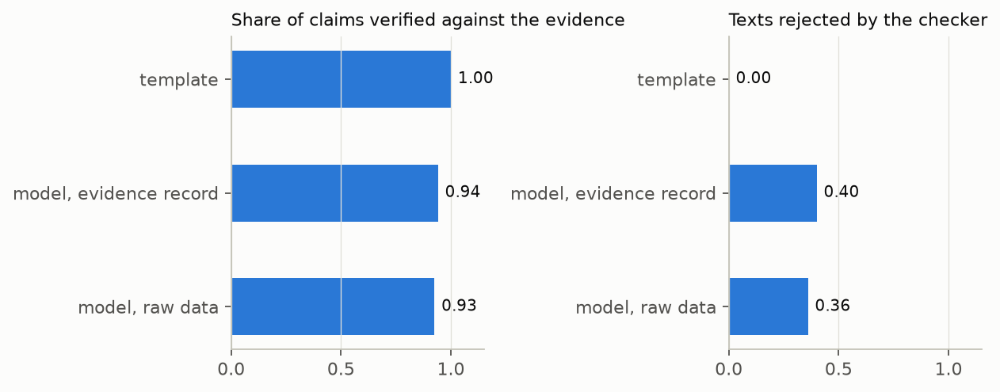

# Evidence-grounded review

Review of longitudinal, multi-source records with evidence-grounded outputs and
controlled error rates.

**A review pipeline in which a language model writes the query text but never
decides what is flagged can be made fully auditable: on 382 companies' SEC
filings, two runs of the detection core gave byte-identical flags and
evidence, every flag carried a schema-validated evidence record, every number
in the template text was traceable to that record, and the audit-log verifier
caught all six simulated tamperings. At the smallest flag budget, 2 flags per
1,000 values, the plausibility layer caught 0.59 injected errors per flag
against 0.40 for accounting identity rules (+0.19, 95% interval 0.15 to 0.24).
The pre-specified primary comparison at 10 per 1,000 was a tie by
construction, because the identity rules alone raise more flags than that
budget allows (0.31 errors per flag, recall 0.31 for both). The statistical
guarantee did not deliver: Benjamini-Hochberg over conformal p-values flagged
nothing at targets of 5% and 10%, and at 20% flagged 329 cells of which 40%
(33% to 46%) were neither injected nor later amended.**

**The checker is what makes the text layer safe, not the input restriction.
On 50 held-out flags, the template put 581 claims into its queries and every
one was in the evidence record. A small local model (`llama3.2:3b`) writing
only from the record had 94% of its claims verifiable and 20 of 50 texts
rejected, every rejection a number that was not in the record; writing from
the raw statements instead, 93% verifiable and 18 of 50 rejected. The
expected gap between the two did not appear. After the checker, no accepted
text contained a number, line item, date, form or accession number outside
the record; 3 of the 30 accepted record-based texts relied on a rounded
figure.**

The question is whether a system that reviews records accumulating over time
from several sources can be made auditable in the sense regulated settings
mean: every flag reproducible, every statement traceable to source data, and
the false-alarm rate controlled, without a language model ever deciding what
to flag. The architecture is domain-agnostic; this repository demonstrates it
on public XBRL company facts from SEC EDGAR (balance sheet, income statement
and cash flow line items of 382 companies over a median of 62 reporting
periods), with injected errors and real corrections from amended filings as
ground truth, on companies held out before any analysis.

<picture>
  <source media="(prefers-color-scheme: dark)" srcset="results/figures/budget_comparison_dark.png">
  
</picture>

## Method in a few sentences

1. **Data.** `companyfacts` and `submissions` from data.sec.gov for 400
   companies drawn with a fixed seed from the entities with at least USD 100
   million of assets in both 2012 and 2023; 382 kept. Twenty standard us-gaap
   line items, the value as first reported for each period: 347,190 cells.
   Every file is pinned in a committed manifest by URL, retrieval date and
   SHA-256; no data are committed. The download declares a user agent and
   stays under the SEC's access rate.
2. **Ground truth.** Values changed in a later 10-K/A or 10-Q/A (373 cells,
   161 held out); 8-K Item 4.02 non-reliance filings (158, by 98 companies);
   and injected errors at 1% of cells in five equal kinds: sign flip, scale
   slip, digit transposition, copy-forward, cross-company swap. Ten
   replicates; 0.5% and 2% as sensitivity analyses.
3. **Split.** 191 development and 191 held-out companies, drawn before any
   detector ran. Everything reported is on held-out companies.
4. **Detection core.** Seven accounting identity rules, then a plausibility
   score for every value from the company's own history and the other items
   of the same period, in plain arithmetic with no transcendental functions,
   so that output bytes do not depend on the machine. Conformal p-values
   calibrated on development companies, Benjamini-Hochberg at 5%, 10% and
   20%, in integer arithmetic.
5. **Evidence and text.** Each flag carries a JSON evidence record listing
   exactly the source values and computed quantities behind it. Query text
   in the form of a comment letter comes from a deterministic template or
   from a language model that sees only the record. A checker rejects any
   sentence with a number, line item, date, form or accession number that is
   not in the record and falls back to the template. An ablation gives the
   model raw data instead of the record.
6. **Audit log.** Append-only JSON lines with a hash chain over versions,
   data manifest, parameters, every flag, every text and every rejection; a
   verifier detects edits, deletions, insertions, swaps, truncation and
   rehashed edits.
7. **Evaluation.** Four detectors (flag nothing, rules only, plausibility
   only, combined) at budgets of 2, 5, 10 and 20 flags per 1,000 cells; 95%
   intervals from a paired company bootstrap averaged over replicates.

The plan, committed before any data were downloaded, is in
`docs/analysis_plan.md` with eight deviations recorded after the results were
seen. The literature and standards check with verified citations is in
`docs/literature_check.md`, the notes on what happened in `docs/notes.md`, and the
validation package (numbered requirements, traceability matrix generated from
the tests, test report, known limitations) in `docs/validation/`.

## Results

All numbers come from `results/tables/*.csv` and `results/summary.json`.

### Injected errors caught per budgeted flag (1% error rate, ten replicates)

| Budget per 1,000 cells | 2 | 5 | **10** | 20 |
|---|---:|---:|---:|---:|
| Flags | 337 | 843 | 1,687 | 3,375 |
| Rules only | 0.40 | 0.41 | 0.31 | 0.19 |
| Plausibility only | **0.59** | 0.41 | 0.28 | 0.17 |
| Combined (rules first) | 0.40 | 0.41 | 0.31 | **0.22** |
| Flag nothing | 0 | 0 | 0 | 0 |
| Plausibility minus rules | +0.19 (0.15 to 0.24) | 0.00 (-0.04 to 0.03) | -0.03 (-0.05 to -0.01) | -0.02 (-0.03 to 0.00) |
| Combined minus rules | 0 | 0 | 0 | +0.03 (0.00 to 0.05) |

The rules raise about 3,140 flags per replicate (1.9% of held-out cells), so
the combined detector equals the rules at the three smaller budgets. Recall
at 20 per 1,000: combined 0.44, rules 0.39, plausibility 0.35. At a 2% error
rate the plausibility ranking is ahead of the rules at 2, 5 and 10 per 1,000
(+0.32, +0.23, +0.04); at 0.5% the rules are ahead at 5 and 10 (-0.06,
-0.03) and the two are level at 2 (`results/tables/budget_differences.csv`).

### Recall by error type at the primary budget

| Error type | Combined (= rules) | Plausibility only | Combined at 20 per 1,000 |
|---|---:|---:|---:|
| Sign flip | 0.63 | 0.39 | 0.65 |
| Scale slip | 0.39 | 0.61 | 0.62 |
| Cross-company swap | 0.32 | 0.35 | 0.41 |
| Digit transposition | 0.10 | 0.07 | 0.27 |
| Copy-forward | 0.10 | 0.004 | 0.28 |

<picture>
  <source media="(prefers-color-scheme: dark)" srcset="results/figures/recall_by_type_dark.png">
  
</picture>

### False-flag rate against target

| Target | Plausibility flags | Achieved false-flag rate | Of which next to an injected cell |
|---|---:|---|---:|
| 5% | 0 | none raised | |
| 10% | 0 | none raised | |
| 20% | 329 | 0.40 (0.33 to 0.46) | 26 of 133 |

A flag is false when its cell is neither injected nor later amended, so this
is an upper bound on the true false-flag rate. The pre-specified variant that
calibrated on injected development data flagged nothing at any target. With
the rules added, 78% to 79% of flags are false by this definition: the filed
data contain many identity violations (mostly cash flow statements that do
not sum within 1%) that are not errors in our sense.

### Real corrections

Of 161 held-out cells later changed in an amendment, the combined detector
caught 9 at the primary budget (recall 0.06, 0 to 0.15) and 13 at 20 per
1,000. Flags were 5.6 times as likely as other cells to fall on an amended
cell (0 to 15.4). In company-periods followed within two years by an 8-K
non-reliance filing the flag rate was 3.2% against 1.0% elsewhere.

### Faithfulness of generated text

| Variant | Texts | Claims | Claims verified | Texts rejected | Accepted texts relying on rounding |
|---|---:|---:|---:|---:|---:|
| Template | 50 | 581 | 100% | 0 | 0 of 50 |
| Model, evidence record only | 50 | 340 | 94.1% | 20 (40%, 27% to 54%) | 3 of 30 |
| Model, raw statements (ablation) | 50 | 454 | 92.5% | 18 (36%, 24% to 50%) | 0 of 32 |

The sample is the first 50 flags of the combined ranking in the primary
replicate; intervals are Wilson intervals for a proportion of 50. Every
rejected text failed on a number: the model restated a reported value with
a wrong scale or stated an arithmetic result that was not in the record.
No text named a line item, date, form or accession number outside the
record. The plan expected the raw-data ablation to be rejected more often;
it was not, within the precision of 50 texts. A plausible reason is that
the record contains computed quantities (differences, tolerances,
predictions) that invite the model to do arithmetic, while the raw table
invites it to quote. After the checker the residual error of the kind it
tests for is zero by construction; the errors it cannot see (a wrong
relation between correct numbers) are left to the reader of
`results/text_examples.md`.

<picture>
  <source media="(prefers-color-scheme: dark)" srcset="results/figures/faithfulness_dark.png">
  
</picture>

### Determinism, audit log and runtime

Two runs of the primary replicate gave identical flags and evidence
(`results/tables/determinism.csv`); CI repeats the quick-universe run on a
second Linux runner with another Python version and compares the hash.
The audit log of the full run has 224,059 entries and verifies intact; all
six simulated tamperings on a copy (edit, delete, insert, swap, truncate,
edit with a recomputed hash) were detected and the untouched control passed
(`results/tables/audit_tamper.csv`). One replicate of the detection core on 168,777 held-out cells
takes about 51 seconds (0.3 seconds per 1,000 cells).

## What this does and does not establish

It establishes that the engineering requirements can be met in a research
pipeline: deterministic flags, evidence records that contain exactly the
inputs of a decision, text that cannot cite anything outside the record, and
a tamper-evident log, with a validation package that traces each requirement
to tests. It does not establish regulatory compliance of anything. The
validation package is modelled on how validated systems are documented and
says so; nobody has qualified this software, and the repository makes no
claim under 21 CFR Part 11, SOX or any other rule. It also establishes a
negative result: in this setting the conformal and Benjamini-Hochberg
guarantee did not control the false-flag rate at the target, for reasons the
paper gives (granularity of the p-values against the number of tests,
collateral flags next to a wrong value, and an incomplete truth).

## Limitations

- The injected errors are mechanical and their rate is an assumption; the
  numbers say how many of those are found, not how many real errors filings
  contain. Copy-forwards and transpositions are largely missed.
- Real corrections are rare, mixed in nature, and rarely visible in one value.
- The rules flag every cell in a violated identity, and the plausibility score
  of a value rises when a neighbouring value is wrong; both inflate the
  false-flag rate as measured.
- The checker verifies claims, not meaning. The local model is small and the
  text sample is 50 flags; the Anthropic backend is implemented but was not
  run.
- Determinism is demonstrated, not proved; it rests on IEEE arithmetic and
  Python's sorting and formatting.
- The universe is large, long-lived filers; small and new companies are
  absent.

## Reproduce

```
git clone https://github.com/Jkovv/evidence-grounded-review
cd evidence-grounded-review
python -m pip install -e ".[dev]"
make all            # download, prepare, detect, evaluate, verify, figures, notebook
make all-quick      # 24 companies and 2 replicates, written to results-quick/
./reproduce.sh      # the same without make
make check          # ruff, mypy, tests with coverage
make validation     # regenerate the traceability matrix and test report
```

Set `EGR_USER_AGENT="Your Name your@email"` for the SEC download,
`EGR_DATA_DIR` to keep the raw files outside the repository, and
`EGR_LLM_BACKEND` (`anthropic`, `ollama` or `openai_compatible`) with
`EGR_LLM_MODEL` to run the language-model variants of the query text; without
them only the template runs. The full run takes about an hour for detection
on a laptop plus the time the language model needs. The committed results
were produced on Python 3.13 with numpy 2.5.4 and scipy 1.18.1; on Python
3.11, which those versions do not support, numpy 2.3.5 and scipy 1.17.0 are
installed instead. The detection core uses neither, so flags and evidence
are unaffected; the bootstrap intervals use numpy's generator. CI runs the tests on
Python 3.11 and 3.13 and the quick pipeline from a clean environment on every
push.

## Citations

The methods reused here are Benjamini and Hochberg (1995), split conformal
p-values with Benjamini-Hochberg (Bates, Candès, Lei, Romano and Sesia 2023),
the two-layer structure of continuous auditing (Kogan, Alles, Vasarhelyi and
Wu 2014), attribution evaluation of generated text (Rashkin et al. 2023; Min
et al. 2023) and hash-chained logs (Haber and Stornetta 1991). The regulatory
expectations followed are 21 CFR Part 11 section 11.10, FDA's computer
software assurance guidance, ISPE GAMP 5 and Sarbanes-Oxley sections 302 and
404. Full references with DOIs are in `docs/literature_check.md`. To cite this
repository use `CITATION.cff`.

## Licence

MIT. The SEC data are public and are not redistributed here; see
`data/README.md`.
